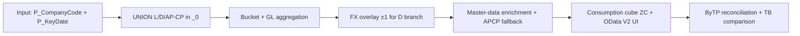
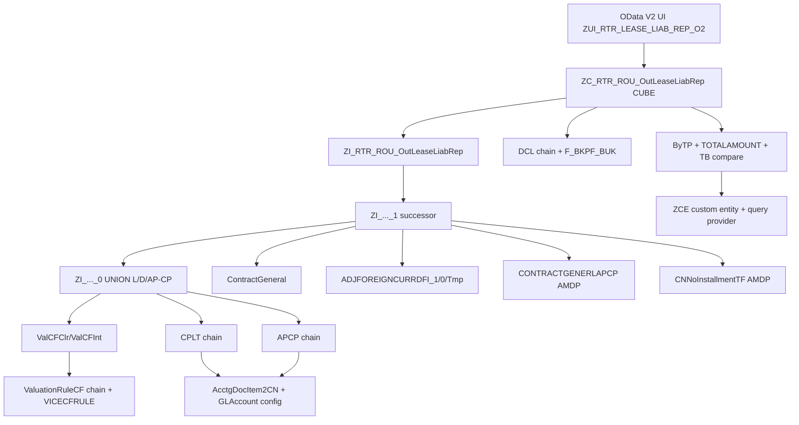

# SMILE — RTR-RE011

## Functional Specification: ZC_RTR_ROU_OutLeaseLiabRep - ROU Outstanding Lease Liability

| Document Attribute | Value |
|---|---|
| Document Origin | Reverse-engineered draft for business confirmation |
| Project Template | templates/default/functional-specification-template.md |
| Template Match / Fallback | default (project_not_specified) |
| SAP System / Client | GSD_120_Z0012353_EN / 120 |
| Root Object | `ZC_RTR_ROU_OutLeaseLiabRep` (DDLS/DF) |
| Analysis Baseline | 2026-11-02 23:23:17 UTC — GSD/120 — package `Z1_RTR_RE_ROU_OUT_LEASE_LIAB_R` (discovered, not supplied) |
| Source Fingerprint | `PARTIAL` — composite: header TRs GSDK911054 + GSDK918255 + GSDK922121; 346-line consumption view; active version read 2026-11-02 |
| Analysis Status (completion) | **STATIC_DEEP_COMPLETE_WITH_LIMITATIONS** |
| Document Status | **DRAFT_PENDING_FUNCTIONAL_CONFIRMATION** |
| Analysis Profile / Output Mode | Extended (depth ≤20, nodes ≤500) / FUNCTIONAL_SPEC |
| Confidentiality | Internal — SMILE project distribution only |

> **Reverse-engineering notice:** This document describes the implemented behavior observed in the analyzed baseline. Items marked **TBD**, **INFERRED**, or **UNVERIFIED** require confirmation and must not be treated as approved business requirements.

## Document Control

### Purpose
As-built Functional Specification for WRICEF RTR-RE011 — Outstanding Lease Liability and Defer Interest Report (consumption view `ZC_RTR_ROU_OutLeaseLiabRep`). Reconstructed strictly from repository evidence on GSD/120 without runtime execution. Intended for business, functional, security and technical reviewers to confirm rules, ownership, and expected results before approval or reuse.

### Version Control

| Version | Date Modified | Description of Change | Modified By |
|---|---|---|---|
| D0.1 | 2026-11-02 | Reverse-engineered first draft (Extended profile, static only) | TBD - requires confirmation |

### Sign-off

| Version | Date | Title and Role | Approver |
|---|---|---|---|
| TBD | TBD | TBD | TBD - requires confirmation |

## Executive Summary

`ZC_RTR_ROU_OutLeaseLiabRep` is the analytical consumption cube (CUBE, size XXL, service quality D) for the SMILE RTR-RE011 Outstanding Lease Liability and Defer Interest Report. It exposes one row per Company Code + Real Estate Contract + Agreement Number + Type, with maturity-bucket amounts (LessThan1Year … GreaterThan15Year), GL current/long-term portions, contract master data, ROU asset economics, and reconciliation keys (Trading Partner, Business Partner, interest rate, fixed asset). It is consumed through OData V2 UI service `ZUI_RTR_LEASE_LIAB_REP_O2` (published) as `OutLeaseLiabRep`, with two sibling exposures for trading-partner reconciliation (`OutLeaseLiabRepByTP`, `OutLeaseContractAcctDocRep`).

Business logic (Observed): three UNION branches in `ZI_RTR_ROU_OutLeaseLiabRep_0` produce Lease (`L`/`L`, from valuation cashflow type 7/Clearing), Defer Interest (`D`/`D`, from cashflow type 3/Interest), and AP-CP (`A`/`L`, from posted AP clearing GL items). Buckets are calendar-month windows relative to `P_KeyDate` (+1…+12, +13…+24, +25…+60, +61…+120, +121…+180, >180). GL current/long-term come from identifiers `CP_ROU_GL` / `LT_ROU_GL` (sign-inverted). A foreign-currency overlay (`ZI_RTR_OLL_ADJFOREIGNCURRDFI_1`) adds `DiffGLCurrentPortion` / `DiffGLLongTerm` to the `D` branch only, and only when the absolute difference is within ±1.00 company-code currency. Master-data fallback chains prefer live RE contract data and fall back to the AP-CP table-function snapshot (`ZI_RTR_OLL_CONTRACTGENERLAPCP` via AMDP `ZCL_RTR_OLL_CONTRACTGENERLAPCP`).

Key findings: (1) AP-CP contributes only to LessThan1Year (other buckets hard-zero) — business intent unconfirmed; (2) `GLCurrentPortion_2` / `GLLongTerm_2` are currently pass-through (adjustment code commented out) while bucket `_2` fields are adjusted — asymmetric and unconfirmed; (3) custom-entity provider `ZCL_RTR_OLL_BYTP_CE` has a copy-paste filter defect (Between5And10Year built twice, Between10And15Year never built) and a total-count defect for multi-company queries; (4) service exposes `ZI_RTR_ROU_OUTLEASELIABREP_TP` as `OutLeaseLiabRepTP` but that object was not found in TADIR — unresolved; (5) binding is published yet API state is `NOT_RELEASED` (C1) — release/transport status needs basis confirmation.

Completion: critical static paths (root → interface → successor → UNION → valuation/GL/AP-CP → AMDPs → service/DCL) are fully source-read. Runtime, role-effectiveness, config values, and business-owned metadata remain UNVERIFIED. Hence `STATIC_DEEP_COMPLETE_WITH_LIMITATIONS`, document remains draft until Blocking confirmations (CQ-01…CQ-04) are answered.

## Table of Contents

- [1. General Information](#1-general-information)
- [2. Program Overview](#2-program-overview)
- [3. Application Name and Description](#3-application-name-and-description)
- [4. Detailed Program Logic](#4-detailed-program-logic)
- [5. Input Parameters](#5-input-parameters)
- [6. User Actions](#6-user-actions)
- [7. Validation](#7-validation)
- [8. Output and Filter Bar](#8-output-and-filter-bar)
- [9. Customized Tables and Configuration](#9-customized-tables-and-configuration)
- [10. Authorizations](#10-authorizations)
- [11. Error Handling](#11-error-handling)
- [12. Testing Procedure](#12-testing-procedure)
- [13. Dependencies and Architecture](#13-dependencies-and-architecture)
- [14. Risks, Assumptions, and Limitations](#14-risks-assumptions-and-limitations)
- [15. Evidence and Coverage Summary](#15-evidence-and-coverage-summary)
- [16. Confirmation Queue](#16-confirmation-queue)
- [Appendix A. Glossary and Technical Object Map](#appendix-a-glossary-and-technical-object-map)
- [Appendix B. Analysis and Template Metadata](#appendix-b-analysis-and-template-metadata)

# 1. General Information

| Attribute | Value | Evidence State |
|---|---|---|
| Description / Objective | Outstanding Lease Liability and Defer Interest Report — maturity-bucket and GL-reconciliation view per RE contract / agreement | FACT |
| Workstream | TBD - requires confirmation (header says Project SMILE) | UNVERIFIED |
| Sub Module | TBD - requires confirmation (RTR — Real Estate / Right-of-Use inferred from objects) | INFERRED |
| Object Name | ROU Outstanding Lease Liability (`ZC_RTR_ROU_OutLeaseLiabRep`) | FACT |
| Related Scope | WRICEF RTR-RE011; package `Z1_RTR_RE_ROU_OUT_LEASE_LIAB_R` (found by search, not supplied — homework objective met) | FACT |
| Extensibility Type | TBD - requires confirmation (custom Z CDS on standard RE-Fx + FI-GL; no released-API verdict available) | UNVERIFIED |
| WRICEF Type | R — Report (from header `WRICEF ID: RTR-RE011`) | FACT |
| Application / Report Type | Analytical CDS cube (`@Analytics.dataCategory: #CUBE`, `@ObjectModel.usageType TRANSACTIONAL/XXL/D`) exposed via OData V2 UI | FACT |
| Front-end Access | OData V2 UI binding `ZUI_RTR_LEASE_LIAB_REP_O2` (published=true); Fiori/UI5 consumption inferred, not evidenced | FACT + INFERRED |
| Priority | TBD - requires business confirmation | TBD |
| Complexity | High — 3-branch UNION, 60+ CDS nodes, 2 AMDP table functions, FX overlay, 5-entity service | DERIVED |
| Processing Type | Read-only analytical query (no writes/commits/LUW in scope) | FACT |
| Schedule / Frequency | TBD - requires business confirmation (key-date driven, as-of reporting) | TBD |
| Transaction Volume | TBD - requires business confirmation (size XXL suggests large RE + FI volume) | TBD |

# 2. Program Overview

## 2.1 Overview of Program Requirement
Provide an as-of (`P_KeyDate`) outstanding lease-liability position per company code, RE contract and agreement, split by remaining-maturity buckets and by GL current/long-term, with defer-interest (DFI) separated from lease (L) and AP-CP accruals, plus contract economics (ROU asset, contract value, NPV, exchange rate, interest rate, options) for disclosure and GL-to-contract reconciliation by trading partner. (Observed from source; business approval pending.)

## 2.2 Scope

### In Scope
- Consumption view `ZC_RTR_ROU_OutLeaseLiabRep` + interface `ZI_RTR_ROU_OutLeaseLiabRep` + successor `_1` + UNION `_0` + FX overlay `_ADJFOREIGNCURRDFI_0/1` + temp `_Tmp`.
- Lease/DFI valuation path (ValuationCFClr/Int ← ValuationRuleCF ← VICECFRULE/VICERULE/VICEPROCESS) and GL path (CPLT ← CPLT_1 ← CPLT_0 ← AcctgDocItem2CN ← `I_OperationalAcctgDocItem` + `ZI_RTR_OLL_GLAccount` config).
- AP-CP path (Agreement ← APCP ← APCP_1 ← APCP_0 ← AcctgDocItem2CN; link `APCP_CONTRACTTOAPCP` / `APCP_LinkToContract` / `CountAgreement`).
- Master-data enrichment (`ContractGeneral` ← `ContractGeneral_0` ← `ZI_REContractData`; partner/interest/asset/qty/vary-on-sales/cond-freq/exch-rate/type2class/vicerule-to-asset; fallback table function `CONTRACTGENERLAPCP` + AMDP `ZCL_RTR_OLL_CONTRACTGENERLAPCP`; installment-count TF + AMDP `ZCL_RTR_CNNOINSTALLMENTTF`).
- Service `ZUI_RTR_LEASE_LIAB_REP_O2` (SRVD+SRVB), DCLs, ByTP reconciliation chain, value helps, config reads (`ZI_EXT_AbapConfiguration`).
- Static authorization inspection (source-level DCL + binding metadata).

### Out of Scope
- Runtime execution, performance measurement, role/user effectiveness (PFCG), transport history, background jobs/forms/print, write/LUW (none in scope), Fiori app implementation, standard RE-Fx/FI internals, historical data migration correctness.
- Excluded with reason: standard SAP internals (`I_*`, `VIC*`, `TIV*`) treated as boundary (`BOUNDARY_STANDARD`, EX-01); live data preview blocked by safety config (`allowDataPreview=false`, EX-02); `ZI_RTR_ROU_OUTLEASELIABREP_TP` missing from TADIR — excluded as unresolved, revisit when object is created/found (EX-03).

## 2.3 Business Actors and Usage

| Actor / Role | Usage | Evidence State |
|---|---|---|
| Lease accountant / RTR analyst (INFERRED) | Run as-of liability ageing, compare contract valuation vs GL, reconcile by trading partner | INFERRED |
| Group consolidation / auditor (INFERRED) | Consume bucket totals, interest-rate min/max, ROU asset vs NPV | INFERRED |
| Security administrator | Maintain DCL inheritance + `F_BKPF_BUK` (BUKRS/ACTVT 03) for ByTP total; assign OData UI access | FACT (source) + UNVERIFIED (role design) |

## 2.4 High-Level Process



Walkthrough: caller passes company code and key date. `_0` unions Lease, Defer-Interest and AP-CP rows filtered by acquisition-posting-date and end-of-term/deactivation year. Valuation cashflows are bucketed by payment-due month relative to key date; GL items are split by `CP_ROU_GL`/`LT_ROU_GL`. The `_1` layer left-joins contract master and the FX-difference view, applies the ±1 tolerance adjustment to `D` rows, and resolves display fields through live-vs-APCP fallback chains. `ZC` projects the result as an analytical cube with value helps and UI line-item annotations. A parallel ByTP chain aggregates the same source by trading partner and compares it to TB (`AcctgDocItem2CN`) for difference reporting.

## 2.5 Main Objects

| Layer / Purpose | Object | Type | Role | Evidence State |
|---|---|---|---|---|
| Consumption (root) | `ZC_RTR_ROU_OutLeaseLiabRep` | DDLS/DF | Analytical cube, parameters P_CompanyCode/P_KeyDate | FACT |
| Interface | `ZI_RTR_ROU_OutLeaseLiabRep` | DDLS/DF | Pass-through to `_1` (successor of `_0`) | FACT |
| Successor | `ZI_RTR_ROU_OutLeaseLiabRep_1` | DDLS/DF | Joins `_0` + ContractGeneral + FX overlay; fallback logic | FACT |
| UNION core | `ZI_RTR_ROU_OutLeaseLiabRep_0` | DDLS/DF | 3-branch UNION L/D/AP-CP | FACT |
| FX overlay | `ZI_RTR_OLL_ADJFOREIGNCURRDFI_1` / `_0` / `_Tmp` | DDLS/DF | Diff GL vs buckets for foreign-currency D rows, tolerance ±1 | FACT |
| Contract master | `ZI_RTR_OLL_ContractGeneral` / `_0` | DDLS/DF | RE contract + ROU class + acquisition dates + ROU asset | FACT |
| Valuation buckets | `ZI_RTR_OLL_ContractValCFClr` / `ContractValCFInt` | DDLS/DF | Maturity-bucket aggregation (types 7 / 3) | FACT |
| GL portions | `ZI_RTR_OLL_ContractCPLT` ← `CPLT` ← `CPLT_1` ← `CPLT_0` | DDLS/DF | Current/long-term from `CP_ROU_GL`/`LT_ROU_GL` | FACT |
| GL source | `ZI_RTR_OLL_AcctgDocItem2CN` | DDLS/DF | `I_OperationalAcctgDocItem` filtered by `ZI_RTR_OLL_GLAccount` | FACT |
| AP-CP | `ZI_RTR_OLL_Agreement` ← `APCP` ← `APCP_1` ← `APCP_0`; `ContractAPCP`; `APCP_CONTRACTTOAPCP`; `APCP_LinkToContract`; `CountAgreement` | DDLS/DF | AP-CP accruals linked to contracts | FACT |
| APCP fallback TF | `ZI_RTR_OLL_CONTRACTGENERLAPCP` + `ZCL_RTR_OLL_CONTRACTGENERLAPCP` (AMDP SQLScript) | TF/AMDP | Distinct APCP snapshot per company/agreement (FIRST_VALUE window) | FACT (resolved) |
| Installment TF | `ZI_RTR_CNNoInstallmentTF` + `ZCL_RTR_CNNOINSTALLMENTTF` (AMDP) | TF/AMDP | Installment count from `VIRULPROC` + posted-rec flag | FACT (resolved) |
| Service | `ZUI_RTR_LEASE_LIAB_REP_O2` (SRVD) + binding (SRVB, OData V2 UI, published) | SRVD/SRVB | Exposes 5 entities incl. root + ByTP reconciliation | FACT |
| Custom entity | `ZCE_RTR_OLL_ByTP` + `ZCL_RTR_OLL_BYTP_CE` (RAP query provider) | CE/CLAS | Fiscal-period-driven ByTP query (defect: filter + count) | FACT |
| Reconciliation | `ZI_RTR_OLL_ByTP` ← `BYTP_0`; `BYTP_TOTALAMOUNT_0/1/2/3`; `AcctDocItemByTP_0/1`; `AcctDocItemByTP`; `AcctDocItemByROU`; `AcctDocItemROUAndTP` | DDLS/DF | TP-level summary vs TB difference | FACT |
| Authorization | `ZC_RTR_ROU_OUTLEASELIABREP`, `ZI_RTR_ROU_OUTLEASELIABREP`, `ZI_RTR_OLL_BYTP`, `ZI_RTR_OLL_BYTP_TOTALAMOUNT_3` (PFCG), `ZC_RTR_ROU_CONTRTACCDOC_BYTP` | DCLS/DL | Inherit + `F_BKPF_BUK` check | FACT |
| Config | `ZI_RTR_OLL_GLAccount_0` ← `ZI_EXT_AbapConfiguration` (`ZBP_I_RTR_ROU_OUTLEASELIABREP`, AP_CP_ROU_GL/CP_ROU_GL/LT_ROU_GL/ROU_CLASS) | DDLS/DF | GL + ROU-class determination (values UNVERIFIED) | FACT (keys) + UNVERIFIED (values) |

# 3. Application Name and Description

| Attribute | Value | Evidence State |
|---|---|---|
| Title | ROU Outstanding Lease Liability (consumption); Outstanding Lease Liability and Defer Interest Report (interface/service) | FACT |
| Subtitle | TBD - requires business confirmation | TBD |
| Floorplan / UI Pattern | Analytical list (presentation variant `pROUOutLeaseLiabRepVariant`, sort CompanyCode ASC, AS_LINEITEM; selection variant bound) + ByTP custom-entity list + Contract-vs-AcctDoc comparison list | FACT (annotations) + INFERRED (Fiori usage) |
| Technical Catalog | TBD - requires confirmation (no FLP catalog evidenced) | TBD |
| Service / Query / Binding | `ZUI_RTR_LEASE_LIAB_REP_O2` v0001 OData V2 UI, published=true, API state NOT_RELEASED/C1; entities: `OutLeaseLiabRep` (ZC), `OutLeaseLiabRepTP` (missing object), `OutLeaseLiabRepByTP` (ZI_RTR_OLL_ByTP), `OutLeaseLiabRepByTP_2` (ZCE_RTR_OLL_ByTP), `OutLeaseContractAcctDocRep` (ZC_RTR_ROU_CONTRTACCDOC_BYTP) | FACT |

# 4. Detailed Program Logic

## 4.1 Processing Sequence
1. Validate `P_CompanyCode` (value help `I_CompanyCodeVH`) and `P_KeyDate`. (FACT — parameters + VH annotations.)
2. Build UNION `_0`: Lease branch (ContractGeneral ⨝ ValCFClr on CompanyCode/Contract, LEFT JOIN CPLT) + DFI branch (ContractGeneral ⨝ ValCFInt) + AP-CP branch (Agreement ⨝ ContractAPCP ⨝ APCP_LinkToContract). Filter: `AssetAcquisitionPostingDate <= P_KeyDate OR IsCNDataMigration='X'`, and `year(ContractEndDate) >= year(P_KeyDate) OR AssetDeactivationYear >= year(P_KeyDate)`. (FACT — EV-04.)
3. Aggregate buckets in ValCFClr/Int and ContractAPCP/CPLT by `YYYYMM(PaymentDueDate)` windows relative to `dats_add_months(P_KeyDate, n)`. (FACT — EV-05/EV-06.)
4. Compute FX overlay `_Tmp` → `_0` → `_1`: group D/L foreign-currency rows, `DiffGLCurrentPortion = Σ(GLCurrentPortion − LessThan1Year)`, `DiffGLLongTerm = Σ(GLLongTerm − Σ other buckets)`; keep only rows where both diffs within ±1. (FACT — EV-07.)
5. In `_1`, adjust `D`/`D` rows: `LessThan1Year_2 = LessThan1Year + DiffGLCurrentPortion` when diff ≠0/not-null; each other bucket gets `DiffGLLongTerm` only when `DiffGLLongTermCondition` = '1'…'5' respectively (first non-zero bucket wins). `GLCurrentPortion_2`/`GLLongTerm_2` are currently unadjusted pass-through (adjustment commented out). (FACT — EV-08; F-03.)
6. Enrich: LEFT JOIN ContractGeneral; resolve CompanyCodeCurrency / REContractCurrency_2 / PaymentMethod / InstallmentFrequency / InterestRateType / options / BusinessPartnerSupplier / TradingPartner / REInterestRate / MasterFixedAsset+FixedAsset / qty / vary-on-sales through live-vs-APCP fallback `CASE` chains; compute RemainingDurationMonths, ContractValue, NetLeaseLiability (valuation amount × ExchangeRate when currencies differ). (FACT — EV-09.)
7. Project consumption `ZC` with texts (`_TypeText`, `_TypeGroupText`, `ROUClassText`, `PaymentMethodText`, `InstallmentFrequencyText`, `ZZ1_InterestRateTypeText`), value helps, `@DefaultAggregation: #SUM` on buckets and `#MIN`/`#MAX` on interest rate, UI line-item positions. Filter `ZC` by `P_CompanyCode` again in `_1` WHERE. (FACT — EV-01.)
8. Parallel: ByTP chain aggregates `ZI_RTR_ROU_OutLeaseLiabRep` (via `BYTP_0`) by CompanyCode/TradingPartner/Type/TypeGroup (SUM buckets, MIN/MAX rate); custom entity `ZCE_RTR_OLL_ByTP` re-queries it per fiscal period (month-end derived from PERIOD+FISCALYEAR filters or system date) and per company (all PTGC companies when COMPANYCODE filter absent); Contract-vs-AcctDoc chain compares summary vs TB (`AcctDocItemByTP_1`) with FULL-OUTER-like UNION ALL (`TOTALAMOUNT_2`) and `AmountDifferent = TB − Summary`. (FACT — EV-10/EV-11.)

## 4.2 Data Selection and Join Logic

| Step | Source | Relation / Join Keys | Filters | Purpose | Evidence ID |
|---:|---|---|---|---|---|
| 1 | `ZI_RTR_OLL_ContractGeneral` + `ZI_RTR_OLL_ContractValCFClr` + `ZI_RTR_OLL_ContractCPLT` (Lease) | INNER ContractGeneral–ValCFClr (CompanyCode, Contract); LEFT to CPLT | Acquisition ≤ KeyDate or CN-migration; end-year/deactivation-year ≥ key-year | Lease liability buckets + GL portions | EV-04 |
| 2 | `ZI_RTR_OLL_ContractGeneral` + `ZI_RTR_OLL_ContractValCFInt` (DFI) | INNER (CompanyCode, Contract) | Same as step 1; GL portions hard-zero | Defer-interest buckets | EV-04 |
| 3 | `ZI_RTR_OLL_Agreement` + `ZI_RTR_APCP_CONTRACTTOAPCP` + `ZI_RTR_OLL_APCP_LinkToContract` (AP-CP) | INNER Agreement–ContractAPCP (Company, Agreement); INNER to LinkToContract; LinkToContract itself joins Agreement+ContractAPCP+ContractGeneral+CountAgreement | `APCP_CONTRACTTOAPCP` non-zero-bucket OR (acquisition < KeyDate or CN) and (deactivation-year or end-year ≥ key-year); `LinkToContract` single-contract rule (Count=1 else blank) | AP-CP accruals attributable to a contract | EV-04 |
| 4 | `ZI_RTR_OLL_ValuationCFClr_0` ← `ValuationRuleCF` ← `ValuationRuleCF_2` ← `ValuationRuleCF_1` ← `ValuationRuleCF_0` ← RE contract + `ZROU%` rules + process steps | Chained via intreno/ruleguid/processguid; hex-substring key derivation | `RECashFlowType='7'` (Clearing); `ZROU%` rules only | Clearing cashflows by payment-due YYYYMM | EV-05 |
| 5 | `ZI_RTR_OLL_ValuationCFInt_0` ← same chain | Same | `RECashFlowType='3'` (Interest); sign-invert on DebitCreditCode='S'; round to 2 decimals | Interest cashflows by payment-due YYYYMM | EV-05 |
| 6 | `ZI_RTR_OLL_CPLT_0` ← `AcctgDocItem2CN` ← `I_OperationalAcctgDocItem` ⨝ `ZI_RTR_OLL_GLAccount` | GL+Company match; config `ZBP_I_RTR_ROU_OUTLEASELIABREP` identifiers | `Identifier IN (CP_ROU_GL, LT_ROU_GL)`; `PostingDate ≤ P_KeyDate` (reverse-doc filter removed 2026-08-22) | GL current/long-term postings | EV-06 |
| 7 | `ZI_RTR_OLL_APCP_0` ← same GL source | Same | `Identifier='AP_CP_ROU_GL'`; AP-invoice flags from doc-type (`K%`, `KU`, `EG`, `EC`) | AP-CP postings | EV-06 |
| 8 | `ZI_RTR_OLL_ADJFOREIGNCURRDFI_0` ← `_Tmp` ← `_0` | Group by Company/Contract/Agreement/TP/currencies | `CompanyCodeCurrency <> REContractCurrency AND Type IN (L,D)`; keep diffs within ±1 | FX-difference isolation | EV-07 |
| 9 | `ZI_RTR_OLL_ContractGeneral_0` ← `ZI_REContractData` ← `I_REContractData` + extension `E_REContract` (ZZ1_*), LEFT `I_CompanyCode` | intreno; CompanyCode | None (filter applied upstream) | Contract master + custom fields | EV-09 |
| 10 | Fallback TF `ZI_RTR_OLL_CONTRACTGENERLAPCP` (AMDP `ZCL_RTR_OLL_CONTRACTGENERLAPCP`) | `FIRST_VALUE … OVER (PARTITION BY companycode, agreementnumber)` over `APCP_OnlyLeaseDFI_1` | `mandt=:p_client AND companycode=:p_companycode` | APCP snapshot when live master is initial/null | EV-12 |
| 11 | Installment TF `ZI_RTR_CNNoInstallmentTF` (AMDP `ZCL_RTR_CNNOINSTALLMENTTF`) | `ROW_NUMBER OVER (PARTITION BY intreno ORDER BY consbeg DESC)`; `COUNT … OVER (…)+posted_rec` | `mandt=:p_client`; `ZROU%` + cftype 7 | Installment count (max-consideration + posted) | EV-12 |

## 4.3 Business Rules and Decision Logic

### Rule BR-01 - Three-way UNION typing
- **Condition:** Source of amounts (valuation clearing vs valuation interest vs posted AP-CP).
- **Processing:** Emit `Type`/`TypeGroup` = `L`/`L` (Lease), `D`/`D` (DFI), `A`/`L` (AP-CP). AP-CP `RealEstateContract` is blank when agreement links to ≠1 contract.
- **Fallback:** AP-CP rows with no attributable contract still appear (blank contract) for completeness.
- **Result:** Consumers must filter/group by Type/TypeGroup; AP-CP contributes only to LessThan1Year (see BR-02).
- **Evidence state:** FACT (Observed).
- **Evidence:** EV-04.
- **Runtime verification:** Business-confirmation (are `L/D/A` labels and `A/L` grouping approved? CQ-01).

### Rule BR-02 - AP-CP bucket mapping (asymmetric)
- **Condition:** AP-CP branch always.
- **Processing:** `LessThan1Year = GLCurrentPortion` (cast); `Between1And2Year … GreaterThan15Year = 0`; `GLCurrentPortion = GLCurrentPortion`; `GLLongTerm = 0`.
- **Fallback:** N/A.
- **Result:** AP-CP ageing is front-loaded; long buckets never show AP-CP.
- **Evidence state:** FACT (Observed).
- **Evidence:** EV-04.
- **Runtime verification:** Business-confirmation (is front-loading intended, or should AP-CP spread by due month like L/D? CQ-02). Finding F-01.

### Rule BR-03 - Foreign-currency tolerance adjustment (NW002)
- **Condition:** `Type='D' AND TypeGroup='D'` AND `DiffGLCurrentPortion <> 0` (not null) for the <1Y bucket; additionally `DiffGLLongTerm <> 0` + `DiffGLLongTermCondition = '1'…'5'` for the matching long bucket.
- **Processing:** Add the diff to the corresponding `_2` bucket; otherwise keep base bucket. `DiffGLLongTermCondition` = first non-zero bucket among 1–2Y→'1', 2–5Y→'2', 5–10Y→'3', 10–15Y→'4', >15Y→'5', else '6' (no adjustment).
- **Fallback:** Rows with diffs outside ±1 are excluded upstream (`WHERE diff BETWEEN -1 AND 1`); L-branch and company-currency-equals-contract-currency rows never enter the overlay.
- **Result:** Small FX rounding gaps are absorbed into the D-branch display buckets.
- **Evidence state:** FACT (Observed).
- **Evidence:** EV-07, EV-08.
- **Runtime verification:** Business-confirmation + Runtime-required (is ±1.00 correct for all currencies? why D-only? CQ-03). Finding F-02.

### Rule BR-04 - Live-vs-APCP fallback priority
- **Condition:** Display fields (currencies, payment method/frequency, interest-rate type/rate, options, partner, trading partner, vary-on-sales).
- **Processing:** Prefer live path (`ContractGeneral` or parameterized association at `P_KeyDate`); when initial/null, use `_ContractGenerlAPCP(P_Client, P_CompanyCode, P_KeyDate)` snapshot; else blank/zero cast.
- **Fallback:** Explicit `CAST('' …)` / `CAST(0 …)` defaults; `CompanyCodeCurrency` falls back through two levels before blank.
- **Result:** Report stays populated even when validity-dated live master has gaps.
- **Evidence state:** FACT (Observed).
- **Evidence:** EV-09.
- **Runtime verification:** Business-confirmation (is APCP snapshot an approved substitute for live master? CQ-04).

### Rule BR-05 - As-of inclusion (acquisition + horizon)
- **Condition:** Every `_0` branch.
- **Processing:** Include when `AssetAcquisitionPostingDate <= P_KeyDate OR IsCNDataMigration='X'`, AND (`year(ContractEndDate) >= year(P_KeyDate)` OR `AssetDeactivationYear >= year(P_KeyDate)`).
- **Fallback:** CN-migrated rows bypass the acquisition check; deactivation-year `99991231` default (from `_ViceruleToAsset_1` when asset has no deactivation date) keeps rows in horizon.
- **Result:** Expired/retired contracts drop out by year granularity (month/day ignored).
- **Evidence state:** FACT (Observed).
- **Evidence:** EV-04.
- **Runtime verification:** Business-confirmation (year-granularity vs exact-date cutoff? CQ-05).

### Rule BR-06 - ByTP aggregation and TB comparison
- **Condition:** Reconciliation views.
- **Processing:** `BYTP_0` casts `_2` buckets; `ByTP` SUMs by Company/TP/Type/TypeGroup with MIN/MAX rate; `TOTALAMOUNT_0` sums six buckets; `TOTALAMOUNT_1` sums across types; `TOTALAMOUNT_2` FULL-OUTER-like UNION ALL vs `AcctDocItemByTP_1` (TB = `Σ(−AmountInCompanyCodeCurrency)` for `PostingDate ≤ KeyDate`); `AmountDifferent = TB − Summary`.
- **Fallback:** `COALESCE(…,0)` on both sides; `DataSource` tags `CONTRACTTOACCTDOCITEM` / `ACCTDOCITEMTOCONTRACT` indicate which side was missing.
- **Result:** One row per Company/TP/currency with summary, TB and difference.
- **Evidence state:** FACT (Observed).
- **Evidence:** EV-10, EV-11.
- **Runtime verification:** Runtime-required (verify difference arithmetic on sample TP; RTC-01).

## 4.4 Field Logic

| No. | Field Name | M/O/C | Type and Length | Functional Description | Source / Logic | Evidence State | Runtime Test |
|---:|---|:---:|---|---|---|---|---|
| 1 | CompanyCode (key) | TBD | `bukrs` | Company code scope; also OData filter + `P_CompanyCode` | `_0.CompanyCode` (= ContractGeneral / Agreement); filtered to `$parameters.P_CompanyCode` in `_1` | FACT | Static-derived |
| 2 | RealEstateContract (key) | TBD | `recnvdmcnnr` | RE contract; blank for multi-contract AP-CP agreements | `_0` keys; AP-CP via `APCP_LinkToContract` (blank when Count≠1) | FACT | Static-derived |
| 3 | AgreementNumber (key) | TBD | `ze_rtr_agreementnumber` | Agreement grouping key (ZZ1 custom) | `ZZ1_AgreementNumber_Rec` (L/D) / `Agreement.AgreementNumber` (AP-CP) | FACT | Static-derived |
| 4 | Type (key) | TBD | `ze_rtr_oll_type` (L/D/A) | Source category: Lease / Defer-Interest / AP-CP | Hard `CAST('L'/'D'/'A')`; VH `ZI_RTR_OLL_Type` (domain `ZD_RTR_OLL_TYPE`) | FACT | Business-confirmation |
| 5 | TypeGroup | TBD | `ze_rtr_oll_typegroup` | Grouping: L for Lease+AP-CP, D for DFI | Hard `CAST('L'/'D')`; VH `ZI_RTR_OLL_TypeGroup` | FACT | Business-confirmation |
| 6 | TypeText / TypeGroupText | TBD | Text | Language-dependent descriptions (`$session.system_language`) | `_Text[1: Language=…]` associations | FACT | Static-derived |
| 7 | ROUClass (+ text) | TBD | `ze_rou_class` | ROU asset class (LAND→1 … VEHICLE→6 mapping) | `_ContractType2Class` via `TIVCEASSETDIF`+`AccDeterClass`; VH `ZI_RTR_OLL_ROUClass` | FACT | Business-confirmation |
| 8 | CompanyCodeCurrency | TBD | `waers` | Display currency for all amounts | Live `ContractGeneral.CompanyCodeCurrency` else APCP snapshot else blank; `@Semantics.amount.currencyCode` anchor | FACT | Static-derived |
| 9 | LessThan1Year … GreaterThan15Year (base) | TBD | Amounts (`ze_rtr_oll_*`) | Maturity buckets from valuation/AP-CP (base, pre-FX) | `ValCFClr/Int` YYYYMM-window SUMs; AP-CP only <1Y populated | FACT | Runtime-required |
| 10 | LessThan1Year … GreaterThan15Year (display, `_2` alias) | TBD | Amounts | Display buckets after FX overlay (what `ZC` exposes as same names) | `BR-03` CASE logic; `@DefaultAggregation #SUM` | FACT | Runtime-required |
| 11 | GLCurrentPortion / GLLongTerm (base) + `_2` display | TBD | `ze_glcurrentportion` / `ze_gllongterm` | GL current/long-term liability; `_2` currently = base (no FX add) | `CPLT` SUM(`CP_ROU_GL`/`LT_ROU_GL` × −1); `_2` pass-through (commented CASE) | FACT | Business-confirmation (F-03) |
| 12 | Contract master (InternalRealEstateNumber, REContractType(+Name NW001), REContractName, dates, durations) | TBD | Mixed | Contract identity + term economics | `ContractGeneral(_0)`; durations via `dats_add_days` month arithmetic; `RemainingDurationMonths` from KeyDate to EndDate | FACT | Static-derived |
| 13 | REContractCurrency / REContractCurrency_2 | TBD | `recnwaers_cn` | Contract currency + resolved display currency | Live else APCP snapshot else blank | FACT | Static-derived |
| 14 | PaymentMethod (+text), InstallmentFrequency (+text) | TBD | `ze_recdpaymentformrh_char1` / `ze_installmentfrequency` | Pay method / frequency at KeyDate | `_ContractCondFreq(P_KeyDate)` (Z1%/Z4%/A% + purpose A/B, max-consideration date) else APCP snapshot | FACT | Business-confirmation |
| 15 | ZZ1 options (DMAPPosted, DMValInstallPosted, InterestRateType(+_2), Retire/Purchase/Terminate/Extension/Guarantee) | TBD | CHAR1/CHAR3 | Data-migration flags + lease options | `ContractGeneral` else APCP snapshot; `IsCNDataMigration = 'X'` when DMValInstallPosted initial? (Observed: `when … is not initial then 'X'` — note inverted naming) | FACT | Business-confirmation |
| 16 | BusinessPartnerSupplier (+name), TradingPartner (+name) | TBD | `ze_businesspartner` / `rassc` | Leasing company + group trading partner | `_ContractSupplier(P_CompanyCode,P_KeyDate)` role `FLVN00` (`MAX(BusinessPartner)`, `_BP001.Vbund`) else APCP snapshot | FACT | Runtime-required |
| 17 | Min/Max REInterestRate | TBD | `ze_receinterestrate` | Interest-rate range across contracts in aggregation | `MIN/MAX(REInterestRate)`; `REInterestRate` = live `_ContractInterest` (ZROU% rules at KeyDate) else APCP snapshot | FACT | Static-derived |
| 18 | MasterFixedAsset / FixedAsset / ExternalID | TBD | `anln1`/`anln2` | Linked fixed asset (substring of `REStatusObjectAsset`) | `_ContractAsset` (ZROU/ZROU_BA rules at KeyDate); positions 7+12 / 19+4 | FACT | Runtime-required |
| 19 | REMeasurementQuantity / Unit, IsVaryOnSales | TBD | Qty/unit + flag | Area/qty + sales-based-rent indicator | `_ContractQty` (max validity object at KeyDate) / `_ContractVaryOnSales` (count A% conditions >0 → 'X') else APCP snapshot | FACT | Business-confirmation |
| 20 | AssetAcquisition/ModificationPostingDate, ROUAsset, ContractValue, NetLeaseLiability, ExchangeRate | TBD | Dates/amounts | Capitalization dates, ROU asset, valuation economics | `ContractValCFSum` (MIN/MAX posting dates, ROUAsset formula); ContractValue/NPV = valuation amount, converted by `_ContractExchRate` when currencies differ | FACT | Runtime-required |
| 21 | TotalInstallmentNo | TBD | `ze_installmentnumber` | Number of installments | `_CNInstallmentPeriodSum` (max-consideration TF + posted count) | FACT | Runtime-required |
| 22 | DummyField | TBD | CHAR5 | Placeholder (`'DUMMY'`) for OData/UI stability | Hard `CAST('DUMMY')` | FACT | N/A |

> M/O/C stays `TBD` — mandatory/optional/conditional intent is business-owned and was not evidenced.

## 4.5 Calculation and Aggregation Details
- Bucket windows use string-compared `YYYYMM`: `concat(Year,Month) BETWEEN substring(dats_add_months(KeyDate,n),1,6) AND substring(…,1,6)` with ranges 1–12 / 13–24 / 25–60 / 61–120 / 121–180 / >180. `dats_add_months(…, 'NULL')` failure mode returns initial → row excluded from that bucket (no error raised in CDS). (FACT.)
- Clearing amounts: `ValuationCFClr_0` rounds to 2 decimals (`round(…,2)`); Interest path sign-inverts when `DebitCreditCode='S'` and rounds in `_0`. GL path multiplies by −1 at `CPLT` level (`CP_ROU_GL`/`LT_ROU_GL`) and again negates TB side (`−AmountInCompanyCodeCurrency`) in ByTP — net sign must be validated at runtime (RTC-01). (FACT.)
- Currency conversion: `ContractValue`/`NetLeaseLiability` = valuation amount when `CompanyCodeCurrency = ValuationCurrency` else `× ExchangeRate` where `ExchangeRate = MAX(ctrate)` from `VICECFRULE` (cfstatus `I`) at earliest posting date per intreno. Null rate → null result (no COALESCE). (FACT — F-08.)
- Aggregations: `@DefaultAggregation: #SUM` on all amount buckets in `ZC`; `#MIN`/`#MAX` on interest rate; `SUM`+`GROUP BY` at every intermediate (ValCFClr/Int, CPLT, APCP, ByTP, TB). Double-count risk if joins fan out is mitigated by pre-aggregation before joins (Observed pattern; runtime sampling still required). (FACT + INFERRED risk.)
- Duration months: `(year(End+1day) − year(Start))×12 + (month(End+1day) − month(Start))` for Contract/Actual; Remaining uses KeyDate instead of Start and returns null when `End = KeyDate` or either date invalid. (FACT.)

## 4.6 Currency, Unit, Date, and Time Semantics
- All amounts carry `@Semantics.amount.currencyCode: 'CompanyCodeCurrency'`; `CompanyCodeCurrency` itself is a resolved fallback (live → APCP → blank). Foreign-currency detection is `CompanyCodeCurrency <> REContractCurrency`. (FACT.)
- `REContractCurrency_2` is the resolved contract currency (live → APCP → blank `recnwaers_cn`). Base `REContractCurrency` is hidden in `ZC`. (FACT.)
- Dates are `dats` day-precision; KeyDate is the single as-of parameter threaded through every parameterized view and both AMDPs (`P_Client=$session.client`, `P_CompanyCode`, `P_KeyDate`). Fiscal-period derivation in the custom entity uses month-end (`MAX(calendardate)` for PERIOD+FISCALYEAR) or current system date when filters are absent. (FACT.)
- Quantities carry unit via `REMeasurementUnit` (`I_UnitOfMeasure` VH); no unit conversion is performed in CDS. (FACT.)

# 5. Input Parameters

| Field Name | Purpose | Mandatory / Optional | Data Type | Default | Value Help | Evidence State |
|---|---|---|---|---|---|---|
| P_CompanyCode | Scope to one company code; re-filtered in `_1`/`_Tmp`/`TOTALAMOUNT_3` | TBD (no OPTIONAL marker; treated as required at runtime) | `bukrs` | None evidenced | `I_CompanyCodeVH` (useForValidation=true) | FACT |
| P_KeyDate | As-of date for validity, bucketing, posting cutoff, FX overlay | TBD | `datum` | None evidenced (custom entity defaults to system month-end when PERIOD+FISCALYEAR absent) | Date (SINGLE selection on contract dates in `ZC`) | FACT |

# 6. User Actions

| Action Name | Trigger / Availability | Processing Logic | Result | Evidence State |
|---|---|---|---|---|
| N/A - analytical read-only view; no custom actions, drafts, determinations or side effects evidenced | N/A | N/A | N/A | FACT (no BDEF/behavior pool in scope; service is query-only) |

# 7. Validation

| No. | Validation | Condition | Message / Behavior | Evidence State |
|---:|---|---|---|---|
| 1 | Company-code value help | `P_CompanyCode` entry | `useForValidation=true` against `I_CompanyCodeVH` | FACT |
| 2 | As-of inclusion | Acquisition/horizon rule (BR-05) | Rows outside horizon are silently excluded (no message in CDS) | FACT |
| 3 | FX tolerance | Diffs outside ±1 | Rows excluded from overlay (`WHERE diff BETWEEN -1 AND 1`); base buckets shown unadjusted | FACT |
| 4 | N/A - no error messages, determinations or validations in CDS source | N/A | N/A - runtime messages (if any) live in the Fiori app, not evidenced | UNVERIFIED |

# 8. Output and Filter Bar

## 8.1 Filter Bar

| Source Object-Field | Field Name | Default | Search / Value Help | Filter | Attribute | Drop-down | Evidence State |
|---|---|---|---|---|---|---|---|
| ZC.CompanyCode | Company Code | None | `I_CompanyCodeVH` + semantic object | hidden consumption filter + mandatory parameter | — | VH-driven | FACT |
| ZC.RealEstateContract | RE Contract | None | `ZI_REContractData` + semantic object REContract | Standard | — | VH-driven | FACT |
| ZC.Type / TypeGroup / ROUClass / PaymentMethod / InstallmentFrequency | Type dimensions | None | `ZI_RTR_OLL_Type/TypeGroup/ROUClass/PaymentMethod/InstallmentFreq` | Standard | Text-associated | VH-driven | FACT |
| ZC.ContractStartDate … REContractSignDate | Contract dates | None | — | SINGLE selection type | — | Calendar | FACT |
| ZC.CompanyCodeCurrency / REContractCurrency_2 | Currencies | None | `I_CurrencyStdVH` | Standard | — | VH-driven | FACT |
| ZCE (PERIOD, FISCALYEAR, COMPANYCODE, TRADINGPARTNER, …) | ByTP custom-entity filters | System month-end when PERIOD+FISCALYEAR absent; all PTGC companies when COMPANYCODE absent | Hand-built ranges in AMDP-backed provider | Standard RAP query filters | Hidden FiscalYear/Period in output | — | FACT |

## 8.2 Output Columns

Output positions follow `@UI.lineItem.position` in `ZC` (10 TypeGroup, 15 Type, 20 CompanyCode, 30 TradingPartner, 40 LessThan1Year, 50 Between1And2Year, 60 Between2And5Year, 70 Between5And10Year, 80 Between10And15Year, 90 GreaterThan15Year, 100 MinRate, 110 MaxRate; others unpositioned). Full column set = §4.4 fields 1–22. Amounts aggregate `#SUM`; rates `#MIN`/`#MAX`. `DummyField` is hidden-technical. Texts resolve in logon language. (FACT.)

# 9. Customized Tables and Configuration

| Configuration Object | Identifier / Key | Value / Range | Purpose | Fallback / Default | Evidence State |
|---|---|---|---|---|---|
| `ZI_EXT_AbapConfiguration` (`ZR_EXT_AbapConfigurationTP`) via `ZI_RTR_OLL_GLAccount_0` | `ProgramName='ZBP_I_RTR_ROU_OUTLEASELIABREP'`, `Identifier IN (AP_CP_ROU_GL, CP_ROU_GL, LT_ROU_GL)`, `ValueSign='I'`, `ValueOption='EQ'` | `ValueLowChar` = GL external account numbers (UNVERIFIED — data preview blocked) | Select which GL accounts feed AP-CP vs current vs long-term | None in source (inner join — unmapped GL accounts silently drop out) | FACT (keys) + UNVERIFIED (values) |
| Same via `ZI_RTR_OLL_AccDeterClass_0` | `Identifier='ROU_CLASS'` | `Parameter1` LAND/BUILDING/PLANT_MACH/TOOL/FIXTURE_FI/VEHICLE → ROUClass 1–6 (mapping in CDS CASE) | Derive ROU class from account-determination value | `else ''` (blank class) | FACT (keys+mapping) + UNVERIFIED (config rows) |
| Domains | `ZD_RTR_OLL_TYPE`, `ZD_RTR_OLL_TYPEGROUP`, `ZD_ROU_CLASS`, `ZD_RECDPAYMENTFORMRH`, `ZD_INSTALLMENTFREQUENCY` | Fixed values via `DDCDS_CUSTOMER_DOMAIN_VALUE` (values UNVERIFIED) | Type/Group/Class/Method/Frequency value helps + texts | None | FACT (domains) + UNVERIFIED (values) |
| `ZI_RTR_OLL_ContractType2Class` | `TIVCEASSETDIF.ObjectType='IS'` + company/contract-type | `MAX(AccountDeterminationValue)` → ROUClass | Contract-type to ROU-class derivation | Blank when no mapping | FACT |

# 10. Authorizations

| Authorization / DCL | Field / Aspect | Mapping Condition | Enforcement Point | Evidence State | Remark |
|---|---|---|---|---|---|
| `ZC_RTR_ROU_OUTLEASELIABREP` (`@AccessControl.authorizationCheck: #CHECK`) | Row-level | `inheriting conditions from ZI_RTR_ROU_OutLeaseLiabRep` | CDS runtime on `OutLeaseLiabRep` | FACT | Chained inheritance; effectiveness depends on PFCG roles (UNVERIFIED) |
| `ZI_RTR_ROU_OUTLEASELIABREP` | Row-level | `inheriting conditions from ZI_RTR_ROU_OutLeaseLiabRep_0` | CDS runtime | FACT | `_0` itself has no DCL evidenced — chain bottoms out (verify) |
| `ZI_RTR_OLL_BYTP` | Row-level | `inheriting conditions from ZI_RTR_ROU_OutLeaseLiabRep` | CDS runtime on ByTP | FACT | Same chain as root |
| `ZI_RTR_OLL_BYTP_TOTALAMOUNT_3` | FI authorization | `(CompanyCode) = aspect pfcg_auth(F_BKPF_BUK, BUKRS, ACTVT='03')` | CDS runtime on Contract-vs-AcctDoc comparison | FACT | Only PFCG-anchored check in scope; display activity only |
| `ZC_RTR_ROU_CONTRTACCDOC_BYTP` | Row-level | `inheriting conditions from ZI_RTR_OLL_BYTP_TOTALAMOUNT_3` | CDS runtime | FACT | Inherits PFCG check above |
| OData/SRV binding | Service access | Binding `ZUI_RTR_LEASE_LIAB_REP_O2` published; API state NOT_RELEASED/C1 | Gateway + IAM | FACT (metadata) | No transaction, role or scope design evidenced — runtime security review required (CQ-06) |

# 11. Error Handling

| No. | Condition / Source | Message or Behavior | Expected Handling | Evidence State |
|---:|---|---|---|---|
| 1 | Invalid dates in duration/bucket functions | `dats_is_valid` guards return null; `dats_add_months(…, 'NULL')` failure yields initial → bucket CASE yields null (row kept, bucket null) | TBD - requires business confirmation (null vs zero semantics) | FACT |
| 2 | Missing master/currency/partner | Fallback chains yield blank/zero casts; `COALESCE` in `_Tmp`/ByTP yields 0 for amounts | TBD - silent substitution may mask data gaps (F-06) | FACT |
| 3 | Missing exchange rate | `Amount × null` → null ContractValue/NPV (no COALESCE) | TBD - requires business confirmation | FACT |
| 4 | N/A - no CDS error messages, exceptions or retry logic | N/A | N/A | FACT (absence in analyzed sources; search scope §15) |

# 12. Testing Procedure

| No. | Scenario | Preconditions / Test Data | Steps | Expected Result | Test Basis |
|---:|---|---|---|---|---|
| 1 | Lease-only company as-of month-end | Company with L contracts, posted acquisition, no FX | Pass P_CompanyCode + month-end P_KeyDate; read buckets + GL portions | Buckets = valuation clearing by due-month windows; GL portions = CP/LT sums × −1; Type=L rows only | Static-derived |
| 2 | DFI foreign-currency tolerance | D contract with CompanyCurrency ≠ ContractCurrency, diff within ±1 | Same; compare base vs `_2` buckets | `_2` = base + diff for <1Y and the single matching long bucket; others = base | Static-derived |
| 3 | DFI foreign-currency outside tolerance | Diff >1.00 | Same | Row excluded from overlay; `_2` = base (verify no silent drop of whole row) | Static-derived |
| 4 | AP-CP single- vs multi-contract agreement | Agreement with 1 contract vs agreement with N contracts | Same | Single → RealEstateContract populated; multi → blank contract, amounts still in <1Y | Static-derived |
| 5 | CN-migration bypass | `ZZ1_DMValInstallPosted_Rec` initial (Observed flag) | Same with acquisition date > KeyDate | Row included via `IsCNDataMigration='X'` path | Static-derived (flag semantics need confirmation) |
| 6 | ByTP reconciliation | TP with both contract and TB postings | Query `ZC_RTR_ROU_CONTRTACCDOC_BYTP` for Company+KeyDate | `AmountDifferent = TB − Summary`; DataSource tag indicates missing side | Static-derived |
| 7 | Custom-entity period default | No PERIOD+FISCALYEAR filter | Query `ZCE_RTR_OLL_ByTP` unfiltered | Month-end of system date used; all PTGC companies looped (verify total count — F-05) | Static-derived |
| 8 | Authorization | User with/without `F_BKPF_BUK` BUKRS/03 | Access each entity | `_TOTALAMOUNT_3` family filters by PFCG; others by inherited DCL | Runtime-required |

## 12.1 Boundary and Negative Tests
- `P_KeyDate` = contract end-date exactly (RemainingDurationMonths returns null by design — confirm display).
- `P_KeyDate` year boundary (inclusion is year-granularity — confirm Dec/Jan cutover).
- Company currency = contract currency (overlay must contribute zero rows — confirm no diff).
- `DiffGLLongTermCondition='6'` (all long buckets zero — confirm no adjustment applied anywhere).
- Multi-company custom-entity query (confirm total-count defect F-05 and per-company paging).
- Between10And15Year filter on custom entity (confirm F-04: filter is ignored, Between5And10Year applied twice).

## 12.2 Runtime Evidence Required
- RTC-01 (P1): Reconcile one TP end-to-end (contract buckets → summary → TB → difference) with FI line items; verify sign conventions (`×−1` twice) and rounding (2-decimal Clearing vs `bapicurext` Interest). `BLOCKED_CAPABILITY` until GUI/data access granted — human steps in Analysis State.
- RTC-02 (P2): Sample foreign-currency D contract with diff ≈ ±1.00; verify tolerance boundary and currency of `DiffGL*` (CompanyCodeCurrency).
- RTC-03 (P2): Sample AP-CP agreement with Count≠1; verify blank-contract row handling in downstream reports.
- RTC-04 (P3): Authorization trace (STUSERTRACE) for a restricted BUKRS user across all five service entities.

# 13. Dependencies and Architecture

## 13.1 Architecture Diagram



Walkthrough: single analytical stack (no BDEF/RAP behavior, no writes). All roads lead through `_0` UNION; valuation, GL and AP-CP sub-chains are independent until `_1` joins them. Two AMDP table functions supply fallback master and installment counts. Service exposes the cube plus two pre-aggregated reconciliation families. Authorization is DCL-inheritance plus one PFCG aspect.

## 13.2 Dependency Summary

| Object | Type | Direction | Relationship | Criticality | Source Status | Evidence State |
|---|---|---|---|---|---|---|
| `ZI_RTR_ROU_OutLeaseLiabRep` | DDLS | Upstream (consumed) | FROM (only dependency of root) | P0 | Read full | CONFIRMED_SOURCE |
| `ZI_RTR_ROU_OutLeaseLiabRep_1` | DDLS | Transitive | FROM | P0 | Read full | CONFIRMED_SOURCE |
| `ZI_RTR_ROU_OutLeaseLiabRep_0` | DDLS | Transitive | FROM (3 UNION branches) | P0 | Read full | CONFIRMED_SOURCE |
| `ZI_RTR_OLL_ContractGeneral(_0)` | DDLS | Transitive | JOIN + associations | P0 | Read full | CONFIRMED_SOURCE |
| `ZI_RTR_OLL_ContractValCFClr/Int` + Valuation chain (7 nodes) | DDLS | Transitive | JOIN/GROUP | P0 | Read full | CONFIRMED_SOURCE |
| `ZI_RTR_OLL_ContractCPLT/CPLT/CPLT_1/CPLT_0/AcctgDocItem2CN` | DDLS | Transitive | JOIN/GROUP | P0 | Read full | CONFIRMED_SOURCE |
| `ZI_RTR_OLL_Agreement/APCP/APCP_1/APCP_0/ContractAPCP/CONTRACTTOAPCP/CONTRACTTOASSET_*` | DDLS | Transitive | JOIN/GROUP | P0 | Read full | CONFIRMED_SOURCE |
| `ZI_RTR_OLL_CONTRACTGENERLAPCP` + `ZCL_RTR_OLL_CONTRACTGENERLAPCP` | TF/AMDP | Transitive | TABLE_FUNCTION_IMPLEMENTATION | P0 | Read full (SQLScript) | CONFIRMED_SOURCE (resolved) |
| `ZI_RTR_CNNoInstallmentTF` + `ZCL_RTR_CNNOINSTALLMENTTF` | TF/AMDP | Transitive | TABLE_FUNCTION_IMPLEMENTATION | P1 | Read full (SQLScript) | CONFIRMED_SOURCE (resolved) |
| `ZI_RTR_OLL_ADJFOREIGNCURRDFI_1/_0/_Tmp` | DDLS | Transitive | JOIN (FX overlay) | P0 | Read full | CONFIRMED_SOURCE |
| `ZUI_RTR_LEASE_LIAB_REP_O2` (SRVD+SRVB) | SRVD/SRVB | Downstream (consumer) | SERVICE_EXPOSURE | P0 | Read metadata | CONFIRMED_REPOSITORY |
| `ZI_RTR_OLL_ByTP` family + `ZCE_RTR_OLL_ByTP` + `ZCL_RTR_OLL_BYTP_CE` | DDLS/CE/CLAS | Downstream | SERVICE_EXPOSURE + query provider | P1 | Read full | CONFIRMED_SOURCE |
| `ZC_RTR_ROU_CONTRTACCDOC_BYTP` family | DDLS | Downstream | SERVICE_EXPOSURE | P1 | Read full | CONFIRMED_SOURCE |
| DCLs (5 roles) | DCLS | Authorization | AUTHORIZATION | P1 | Read full | CONFIRMED_SOURCE |
| `ZI_RTR_ROU_OUTLEASELIABREP_TP` | Unknown | Downstream (service-declared) | SERVICE_EXPOSURE (declared, not found) | P1 | Not found (TADIR miss) | UNRESOLVED |
| Standard `I_*` / `VIC*` / `TIV*` / `E_REContract` | DDLS/TABL | Boundary | JOIN/association | P2 | Inventoried, not deep-read | BOUNDARY_STANDARD |

## 13.3 CDS Discovery Metrics

| Metric | Result |
|---|---:|
| Raw dependency occurrences | ~180+ (occurrences across 60+ views incl. repeated `_ContractGenerlAPCP` parameterized paths) |
| Unique canonical objects | 71 (58 DDLS + 2 TF + 2 AMDP classes + 1 CE + 1 query-provider class + 5 DCL + 1 SRVD + 1 SRVB + 1 missing candidate) |
| Unique directed edges | 96 (FROM 34, JOIN 22, ASSOCIATION 28, TABLE_FUNCTION_IMPLEMENTATION 2, SERVICE_EXPOSURE 5, AUTHORIZATION 5) |
| Maximum observed depth | 11 (ZC → ZI → _1 → _0 → APCP_CONTRACTTOAPCP → CONTRACTTOASSET_3 → _2 → _1 → _0 → VICERULE → REContractData) |
| Fully / Partially / Unresolved | 69 / 1 (SRVB metadata only) / 1 (`OUTLEASELIABREP_TP` missing) |
| Table-function / AMDP resolution | 2/2 resolved (100%) — both SQLScript implementations read |
| DCL resolution | 5/5 read (100%); effectiveness UNVERIFIED (no role trace) |
| Critical-path coverage | 100% static (all P0 UNION/bucket/GL/FX/fallback paths source-read) |

# 14. Risks, Assumptions, and Limitations

## 14.1 Findings Register

| Finding ID | Type | Severity | Defect Existence | Current Impact | Potential Impact | Object / Location | Evidence | Why It Matters | Human Action |
|---|---|---|---|---|---|---|---|---|---|
| F-01 | DESIGN_RISK | Medium | Probable | Unverified | Possible | `ZI_RTR_ROU_OutLeaseLiabRep_0` AP-CP branch (LessThan1Year=GLCurrentPortion, others 0) | EV-04 | AP-CP ageing is front-loaded; long-bucket disclosure may understate AP-CP if business expects spread by due month | Confirm with business (CQ-02); if spread needed, rework `ContractAPCP` bucketing |
| F-02 | BUSINESS_RULE_CONFIRMATION | Medium | Probable | Unverified | Possible | `ADJFOREIGNCURRDFI_1` (±1 tolerance, D-only) | EV-07/EV-08 | Tolerance may be wrong currency-scale; L-branch FX gaps never adjusted | Confirm tolerance + D-only scope (CQ-03) |
| F-03 | PROBABLE_STATIC_DEFECT | Medium | Probable | Unverified | Possible | `ZI_RTR_ROU_OutLeaseLiabRep_1` (`GLCurrentPortion_2`/`GLLongTerm_2` pass-through, adjustment commented) | EV-08 | Display GL portions ignore FX diff while buckets absorb it → bucket-vs-GL tie-out breaks for FX D rows | Confirm intent; either restore CASE or document pass-through |
| F-04 | CONFIRMED_STATIC_DEFECT | High | Confirmed | Probable | Probable | `ZCL_RTR_OLL_BYTP_CE` (Between5And10Year range built twice; Between10And15Year never built) | EV-11 | ByTP custom-entity filter on Between10And15Year is silently ignored; Between5And10Year applied twice (harmless duplicate) | Fix provider (one-line correction); retest RTC-01 boundary |
| F-05 | CONFIRMED_STATIC_DEFECT | High | Confirmed | Probable | Probable | `ZCL_RTR_OLL_BYTP_CE` total-count (uses last-loop company only) | EV-11 | Multi-company ByTP queries report wrong total-record count → paging breaks | Fix count loop (sum per company); retest |
| F-06 | DATA_INTEGRITY | Low | Possible | Unverified | Possible | Fallback chains (`COALESCE`/blank casts) + `IsCNDataMigration` derivation | EV-09 | Silent substitution may mask master-data gaps; flag name suggests inverted semantics (`is not initial → 'X'`) | Confirm flag semantics (CQ-04); consider data-quality report |
| F-07 | PERFORMANCE | Medium | Possible | Unverified | Possible | XXL/C/D cube over `I_OperationalAcctgDocItem` + 11-deep parameterized associations per row | EV-06/EV-13 | Per-row parameterized association calls (`_ContractGenerlAPCP(…)`, `_ContractSupplier(…)`) risk row-by-row execution at scale | Runtime: test with production-scale company + ST05/SQL trace (RTC-05) |
| F-08 | DESIGN_RISK | Low | Possible | Unverified | Possible | `ContractValue`/`NetLeaseLiability` (null when ExchangeRate null) | EV-09 | Missing rate yields null economics instead of fallback/error | Confirm fallback (CQ-07) |
| F-09 | SECURITY_OBSERVATION | Medium | Probable | Unverified | Possible | Service published + `NOT_RELEASED`/C1; `_0` has no own DCL; custom entity has no DCL evidenced | EV-10/EV-14 | Data may be consumable beyond intended audience until roles + release are settled | Security review: roles, release, CE authorization (CQ-06) |
| F-10 | UNVERIFIED_CONCERN | Medium | Unverified | Unverified | Possible | Service entity `OutLeaseLiabRepTP` → `ZI_RTR_ROU_OUTLEASELIABREP_TP` (TADIR miss) | EV-10 | Service definition references a non-existent object — activation/consistency risk | Basis/ADT check: create, remove, or correct the exposure |

## 14.2 Risks, Assumptions, and Limitations

| ID | Type | Description | Impact | Recommendation | State |
|---|---|---|---|---|---|
| R-01 | Assumption | Business labels for Type (L/D/A), TypeGroup, ROUClass 1–6, tolerance ±1 are INFERRED from technical naming | Mislabelled disclosure | Confirm CQ-01/CQ-03 before external use | INFERRED |
| R-02 | Limitation | No runtime, no data preview (`allowDataPreview=false`), no role trace, no config values | Amounts, signs, rounding, authorization unverified | Execute RTC-01…RTC-05 with granted access | UNVERIFIED |
| R-03 | Limitation | Standard RE-Fx/FI tables treated as boundary (not deep-read) | Upgrade/clean-core verdict incomplete | Run clean-core ATC + released-API check per object | UNVERIFIED |
| R-04 | Risk | Reverse-doc filter removed from `CPLT_1` (2026-08-22: include reversed docs) | GL portions may double-count reversed postings | Confirm with FI (CQ-08); runtime TB tie-out | Possible |
| R-05 | Risk | Year-granularity horizon + `99991231` deactivation default | Expired contracts linger / cutover surprises | Confirm BR-05 granularity (CQ-05) | Possible |

# 15. Evidence and Coverage Summary

## 15.1 Coverage

| Dimension | Coverage | Denominator | Notes |
|---|---|---:|---|
| SOURCE (unique custom objects) | 69 verified / 71 in scope (97%) | 71 | 69 full reads; 1 partial (SRVB metadata); 1 unresolved (missing TP view) |
| DEPENDENCY (unique edges) | 96 / 96 confirmed or bounded (100% static) | 96 | All P0/P1 edges CONFIRMED_SOURCE except 5 service/DCL (repository) + 1 unresolved |
| CAPABILITY | 3 / 3 mapped (position ageing, GL tie-out, TP reconciliation) | 3 | INFERRED names — need business confirmation |
| ENTITY | 12 / 12 classified (contract, valuation, GL item, AP-CP, partner, asset, qty, rate, installment, TP, TB, config) | 12 | Master vs history vs config distinguished |
| CONFIGURATION | 2 / 4 verified (keys+mapping FACT; values UNVERIFIED) | 4 | GL identifiers + ROU_CLASS keys read; row values + domain values blocked |
| INBOUND | 2 / 2 known consumers verified; repository-wide completeness Not Scorable | 2 | Service + ByTP are the only evidenced consumers; live where-used not exhaustive |
| AUTHORIZATION | 5 / 5 source-read (100%); effectiveness 0% (no trace) | 5 | Separate source inspection from runtime validation |
| TABLE_FUNCTION/AMDP | 2 / 2 resolved (100%) | 2 | Both SQLScript implementations read |
| DCL | 5 / 5 read (100%) | 5 | Inheritance + PFCG aspect captured |
| UNION_BRANCH | 3 / 3 represented (L/D/AP-CP) | 3 | All branches + WHERE clauses read |
| FIELD_LINEAGE (critical) | 22 / 22 traced to source expression (100% static) | 22 | §4.4; runtime value-proof pending |
| RUNTIME | 0 / 5 handoffs executed (0%) | 5 | Static-only analysis by design (no execution) |

## 15.2 Evidence Register

| Evidence ID | Object / Source | Location / Relation | Supports | State | Limitation |
|---|---|---|---|---|---|
| EV-01 | `ZC_RTR_ROU_OutLeaseLiabRep` (346 lines, active) | Root source + header (SMILE/RTR-RE011/TRs) | Root intent, parameters, projections, UI/VH | FACT | No hash API — PARTIAL fingerprint |
| EV-02 | TADIR lookup (6 names) | Package `Z1_RTR_RE_ROU_OUT_LEASE_LIAB_R` for all found objects | Homework: package discovered without hint | FACT | `OUTLEASELIABREP_TP` missing |
| EV-03 | `SAPContext impact` | Upstream ZI; downstream SRVD + DCL; sibling check | Blast radius (service + auth) | FACT | Live where-used bounded, not exhaustive |
| EV-04 | `ZI_RTR_ROU_OutLeaseLiabRep_0` | 3 UNION branches + WHERE + AP-CP mapping | BR-01/BR-02/BR-05, F-01 | FACT | None (full read) |
| EV-05 | Valuation chain (ValCFClr/Int + RuleCF 0/1/2 + CFClr_0/CFInt_0) | Bucket CASE + `cftype 7/3` + `ZROU%` + rounding | Bucket logic, F-07 context | FACT | Standard VIC* boundary |
| EV-06 | GL chain (CPLT/CPLT_1/CPLT_0/AcctgDocItem2CN/GLAccount_0/APCP_0/1) | Identifiers + sign + doc-type flags + reverse-doc removal | GL/AP-CP sourcing, R-04 | FACT | Config values + live FI data UNVERIFIED |
| EV-07 | `ADJFOREIGNCURRDFI_0/1` + `_Tmp` | Diff formulas + ±1 WHERE + condition CASE | BR-03, F-02 | FACT | None (full read) |
| EV-08 | `ZI_RTR_ROU_OutLeaseLiabRep_1` | FX CASE per bucket + commented GL CASE | BR-03/BR-04, F-03 | FACT | None (full read) |
| EV-09 | `ContractGeneral(_0)` + partner/interest/asset/qty/condfreq/exchrate/type2class/vicerule + `_1` fallbacks | CASE chains + validity + conversions | BR-04, §4.4 fields 12–20, F-06/F-08 | FACT | Domain/config values UNVERIFIED |
| EV-10 | `ZUI_RTR_LEASE_LIAB_REP_O2` (SRVD) + SRVB metadata | 5 exposures; V2 UI; published=true; NOT_RELEASED/C1 | Service scope, F-09/F-10 | FACT | No app/catalog evidenced |
| EV-11 | ByTP chain (`ByTP/BYTP_0/TOTALAMOUNT_0-3/AcctDocItemByTP*`) + `ZCE` + `ZCL_RTR_OLL_BYTP_CE` (full class) | Aggregation + TB compare + provider filters/count | BR-06, F-04/F-05 | FACT | None (full read) |
| EV-12 | AMDPs (`ZCL_RTR_OLL_CONTRACTGENERLAPCP`, `ZCL_RTR_CNNOINSTALLMENTTF`) | SQLScript FIRST_VALUE / ROW_NUMBER windows | Fallback + installment logic (resolved, not blocked) | FACT | HANA-only review (no explain plan) |
| EV-13 | Annotations (`@Analytics`, `@ObjectModel.usageType`, `@UI`, `@Semantics`, `@Consumption`) | Root + `_1` + `ZC` | Cube semantics, aggregation, VH, UI positions | FACT | Front-end behavior INFERRED |
| EV-14 | DCLs (5 roles) | Inherit + `F_BKPF_BUK` aspect | §10, F-09 | FACT | Role effectiveness UNVERIFIED |
| EV-15 | Config keys (`ZI_EXT_AbapConfiguration`, domains, `AccDeterClass`) | Program/identifier keys + CASE mappings | §9 | FACT (keys) | Values UNVERIFIED (preview blocked) |

## 15.3 Completion Statement
Analysis status: **STATIC_DEEP_COMPLETE_WITH_LIMITATIONS**. All in-scope critical static paths (UNION → buckets → GL → AP-CP → FX → fallback → service/DCL, both AMDPs) are source-read and traced; 69/71 objects verified, 96/96 edges bounded, 22/22 critical fields lineaged, 3/3 UNION branches represented, 2/2 table functions resolved, 5/5 DCLs read. Runtime verification (0/5), role effectiveness, config values, business-owned metadata, and the missing TP view remain open. Stop reason: Extended budget sufficient for static depth 11/71 nodes; further progress requires runtime access and business confirmations, not more static reads. No `DEEP_COMPLETE` claimed.

# 16. Confirmation Queue

| ID | Topic | Question / Required Decision | Suggested Owner | Priority | Blocking |
|---|---|---|---|---|---|
| CQ-01 | Type semantics | Are `Type` L=Lease, D=Defer-Interest (DFI), A=AP-CP and `TypeGroup` L/D groupings the approved business labels? | Functional (RTR) | Blocking | Yes |
| CQ-02 | AP-CP ageing | Is front-loading all AP-CP into LessThan1Year (other buckets zero) correct, or should AP-CP spread by due month? | Functional (RTR) | Blocking | Yes |
| CQ-03 | FX tolerance | Is ±1.00 (company-code currency) the approved tolerance, and is D-only adjustment correct (why not L)? | Functional + FI | Blocking | Yes |
| CQ-04 | Fallback + CN flag | Is the APCP-snapshot fallback an approved substitute for live master? What does `IsCNDataMigration='X'` (derived when DMValInstallPosted initial?) formally mean? | Functional + Data migration lead | Blocking | Yes |
| CQ-05 | Horizon granularity | Is year-granularity inclusion (`year(End) ≥ year(KeyDate)`) approved, or is exact-date cutoff required? | Functional | Required before testing | No |
| CQ-06 | Authorization + release | Confirm intended audience/roles for all 5 service entities; is `NOT_RELEASED`/C1 + published binding the correct release state? Is custom entity intentionally without DCL? | Security + Basis | Required before sign-off | No |
| CQ-07 | Null economics | When exchange rate is missing, should ContractValue/NPV be null, zero, or error? | Functional (FI) | Required before testing | No |
| CQ-08 | Reversed docs | Was removing the reverse-document exclusion from `CPLT_1` (GSDK928504) intended to include reversed postings in GL portions? | Functional (FI) | Required before testing | No |
| CQ-09 | Missing TP view | What is `ZI_RTR_ROU_OUTLEASELIABREP_TP` (service entity `OutLeaseLiabRepTP`)? Create, remove, or correct the exposure? | Technical (ADT/Basis) | Documentation only | No |
| CQ-10 | Volumes/schedule | Confirm expected companies/contracts volume, refresh schedule, and performance SLAs for the XXL cube. | Business + Basis | Documentation only | No |

# Appendix A. Glossary and Technical Object Map

## A.1 Glossary

| Term | Meaning | Technical Name (if any) | Evidence State |
|---|---|---|---|
| ROU | Right-of-Use (INFERRED — lease accounting asset/liability) | `ROUClass`, `ROUAsset` | INFERRED |
| DFI | Defer Interest (Observed branch label in headers: Defer Interest Report) | `Type='D'` | FACT (label) + INFERRED (expansion) |
| AP-CP | Advance Payment – Clearing? / AP Clearing Postings? (TBD — acronym not expanded in source) | `Type='A'`, `AP_CP_ROU_GL` | TBD |
| CPLT | Current Portion / Long Term (Observed: GL current/long-term split) | `CP_ROU_GL` / `LT_ROU_GL` | FACT (usage) |
| TP | Trading Partner (group affiliate for elimination) | `TradingPartner` (`rassc`, `I_Globalcompany`) | FACT |
| Key Date | As-of date driving validity, bucketing and posting cutoff | `P_KeyDate` | FACT |
| CN | China? / Company? migration flag (TBD — `IsCNDataMigration`, `CNInstallment`) | `ZZ1_DMValInstallPosted_Rec` | TBD |
| SMILE | Project name from source headers | — | FACT |
| WRICEF RTR-RE011 | Report object identifier | — | FACT |

## A.2 Technical Object Map

| Business Concept | Technical Object | Type | Package | Role |
|---|---|---|---|---|
| Outstanding liability cube | `ZC_RTR_ROU_OutLeaseLiabRep` | DDLS | `Z1_RTR_RE_ROU_OUT_LEASE_LIAB_R` | Consumption |
| Liability interface | `ZI_RTR_ROU_OutLeaseLiabRep` (+ `_1`, `_0`, `_Tmp`) | DDLS | Same | Staging/UNION/FX |
| Contract master | `ZI_RTR_OLL_ContractGeneral(_0)` ← `ZI_REContractData` | DDLS | Same (+ RE standard) | Master enrichment |
| Valuation buckets | `ZI_RTR_OLL_ContractValCFClr/Int` + RuleCF chain | DDLS | Same | Ageing source |
| GL portions | `ZI_RTR_OLL_ContractCPLT/CPLT/CPLT_1/CPLT_0/AcctgDocItem2CN` | DDLS | Same | GL source |
| AP-CP accruals | `ZI_RTR_OLL_Agreement/APCP*/ContractAPCP/CONTRACTTO*` | DDLS | Same | AP-CP source |
| APCP snapshot | `ZI_RTR_OLL_CONTRACTGENERLAPCP` + `ZCL_RTR_OLL_CONTRACTGENERLAPCP` | TF/CLAS | Same | Fallback (AMDP resolved) |
| Installments | `ZI_RTR_CNNoInstallmentTF` + `ZCL_RTR_CNNOINSTALLMENTTF` | TF/CLAS | Same | Count (AMDP resolved) |
| OData service | `ZUI_RTR_LEASE_LIAB_REP_O2` | SRVD/SRVB | Same | Exposure (V2 UI, published) |
| TP reconciliation | `ZI_RTR_OLL_ByTP*`, `ZCE_RTR_OLL_ByTP`, `ZC_RTR_ROU_CONTRTACCDOC_BYTP` | DDLS/CE | Same | Reconciliation |
| Authorization | 5× DCLS roles | DCLS | Same | Access control |
| GL/ROU config | `ZI_RTR_OLL_GLAccount(_0)`, `AccDeterClass(_0)`, `ZI_EXT_AbapConfiguration` | DDLS | Same | Configuration keys |

# Appendix B. Analysis and Template Metadata

```yaml
analysis_method: reverse_engineering
document_intent: functional_specification
document_scope: as_is
audience: [functional, technical]
analysis_profile: extended
output_mode: FUNCTIONAL_SPEC
analysis_status: STATIC_DEEP_COMPLETE_WITH_LIMITATIONS
document_status: DRAFT_PENDING_FUNCTIONAL_CONFIRMATION
template_selection:
  requested: null
  selected: templates/default/functional-specification-template.md
  match_method: default
  template_version: "8.3"
  template_fingerprint: BC342183F6122630BA8EA853B4D2416B0DA42A2DCE8A9A69D553A436D22BC4A5
  fallback_reason: project_not_specified
```

Evidence states: **FACT** (directly observed), **DERIVED** (calculated from facts), **INFERRED** (likely meaning, needs confirmation), **UNVERIFIED** (unavailable, blocked, or runtime-dependent).

> DATA_REDACTION_REVIEW_PASSED — no credentials, personal data, bank details, or bulk transactional samples reproduced; only object/field names and source logic excerpts included.

---

**Generated from reverse-engineering evidence. Validate with business, functional, security, and technical owners before approval or implementation use.**
