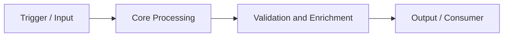
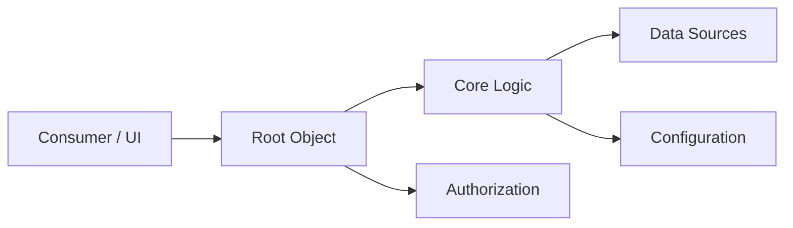

# {{PROJECT_NAME}}

## Functional Specification: {{OBJECT_ID}} - {{OBJECT_TITLE}}

| Document Attribute | Value |
|---|---|
| Document Origin | {{DOCUMENT_ORIGIN}} |
| Project Template | {{SELECTED_TEMPLATE}} |
| Template Match / Fallback | {{TEMPLATE_SELECTION_RESULT}} |
| SAP System / Client | {{SYSTEM_CLIENT}} |
| Root Object | `{{ROOT_OBJECT}}` |
| Analysis Baseline | {{BASELINE_TIMESTAMP}} |
| Source Fingerprint | `{{SOURCE_FINGERPRINT}}` |
| Analysis Status (completion) | **{{COMPLETION_STATUS}}** |
| Document Status | **{{DOCUMENT_STATUS}}** |
| Analysis Profile / Output Mode | {{PROFILE_AND_OUTPUT_MODE}} |
| Confidentiality | {{CONFIDENTIALITY}} |

> **Reverse-engineering notice:** This document describes the implemented behavior observed in the analyzed baseline. Items marked **TBD**, **INFERRED**, or **UNVERIFIED** require confirmation and must not be treated as approved business requirements.

## Document Control

### Purpose
{{DOCUMENT_PURPOSE}}

### Version Control

| Version | Date Modified | Description of Change | Modified By |
|---|---|---|---|
| D0.1 | {{DATE}} | Reverse-engineered first draft | {{AUTHOR_OR_TBD}} |

### Sign-off

| Version | Date | Title and Role | Approver |
|---|---|---|---|
| TBD | TBD | TBD | TBD - requires confirmation |

## Executive Summary

{{EXECUTIVE_SUMMARY}}

> Target one to two pages: what the solution does, who uses it, key rules, key findings, analysis status, document status, and what needs confirmation.

## Table of Contents

- [1. General Information](#1-general-information)
- [2. Program Overview](#2-program-overview)
- [3. Application Name and Description](#3-application-name-and-description)
- [4. Detailed Program Logic](#4-detailed-program-logic)
- [5. Input Parameters](#5-input-parameters)
- [6. User Actions](#6-user-actions)
- [7. Validation](#7-validation)
- [8. Output and Filter Bar](#8-output-and-filter-bar)
- [9. Customized Tables and Configuration](#9-customized-tables-and-configuration)
- [10. Authorizations](#10-authorizations)
- [11. Error Handling](#11-error-handling)
- [12. Testing Procedure](#12-testing-procedure)
- [13. Dependencies and Architecture](#13-dependencies-and-architecture)
- [14. Risks, Assumptions, and Limitations](#14-risks-assumptions-and-limitations)
- [15. Evidence and Coverage Summary](#15-evidence-and-coverage-summary)
- [16. Confirmation Queue](#16-confirmation-queue)
- [Appendix A. Glossary and Technical Object Map](#appendix-a-glossary-and-technical-object-map)
- [Appendix B. Analysis and Template Metadata](#appendix-b-analysis-and-template-metadata)

# 1. General Information

| Attribute | Value | Evidence State |
|---|---|---|
| Description / Objective | {{OBJECTIVE}} | {{STATE}} |
| Workstream | {{WORKSTREAM_OR_TBD}} | {{STATE}} |
| Sub Module | {{SUBMODULE_OR_TBD}} | {{STATE}} |
| Object Name | {{OBJECT_TITLE}} | FACT |
| Related Scope | {{RELATED_SCOPE_OR_TBD}} | {{STATE}} |
| Extensibility Type | {{EXTENSIBILITY_OR_TBD}} | {{STATE}} |
| WRICEF Type | {{WRICEF_OR_TBD}} | {{STATE}} |
| Application / Report Type | {{REPORT_TYPE_OR_TBD}} | {{STATE}} |
| Front-end Access | {{FRONTEND_OR_TBD}} | {{STATE}} |
| Priority | {{PRIORITY_OR_TBD}} | {{STATE}} |
| Complexity | {{COMPLEXITY}} | DERIVED |
| Processing Type | {{PROCESSING_TYPE}} | {{STATE}} |
| Schedule / Frequency | {{SCHEDULE_OR_TBD}} | {{STATE}} |
| Transaction Volume | {{VOLUME_OR_TBD}} | {{STATE}} |

# 2. Program Overview

## 2.1 Overview of Program Requirement
{{BUSINESS_OVERVIEW}}

## 2.2 Scope

### In Scope
{{IN_SCOPE}}

### Out of Scope
{{OUT_OF_SCOPE}}

## 2.3 Business Actors and Usage

| Actor / Role | Usage | Evidence State |
|---|---|---|
{{ACTOR_ROWS}}

## 2.4 High-Level Process



{{PROCESS_EXPLANATION}}

## 2.5 Main Objects

| Layer / Purpose | Object | Type | Role | Evidence State |
|---|---|---|---|---|
{{MAIN_OBJECT_ROWS}}

# 3. Application Name and Description

| Attribute | Value | Evidence State |
|---|---|---|
| Title | {{APP_TITLE_OR_TBD}} | {{STATE}} |
| Subtitle | {{APP_SUBTITLE_OR_TBD}} | {{STATE}} |
| Floorplan / UI Pattern | {{FLOORPLAN_OR_TBD}} | {{STATE}} |
| Technical Catalog | {{CATALOG_OR_TBD}} | {{STATE}} |
| Service / Query / Binding | {{SERVICE_EXPOSURE}} | {{STATE}} |

# 4. Detailed Program Logic

## 4.1 Processing Sequence
{{PROCESSING_SEQUENCE}}

## 4.2 Data Selection and Join Logic

| Step | Source | Relation / Join Keys | Filters | Purpose | Evidence ID |
|---:|---|---|---|---|---|
{{DATA_SELECTION_ROWS}}

## 4.3 Business Rules and Decision Logic

### Rule BR-001 - {{RULE_TITLE}}
- **Condition:** {{CONDITION}}
- **Processing:** {{PROCESSING}}
- **Fallback:** {{FALLBACK}}
- **Result:** {{RESULT}}
- **Evidence state:** {{STATE}}
- **Evidence:** {{EVIDENCE_IDS}}
- **Runtime verification:** {{RUNTIME_NEED}}

{{ADDITIONAL_RULES}}

## 4.4 Field Logic

| No. | Field Name | M/O/C | Type and Length | Functional Description | Source / Logic | Evidence State | Runtime Test |
|---:|---|:---:|---|---|---|---|---|
{{FIELD_LOGIC_ROWS}}

> M/O/C must be populated only when confirmed. Otherwise use `TBD` and add a confirmation item.

## 4.5 Calculation and Aggregation Details
{{CALCULATION_DETAILS}}

## 4.6 Currency, Unit, Date, and Time Semantics
{{SEMANTIC_DETAILS}}

# 5. Input Parameters

| Field Name | Purpose | Mandatory / Optional | Data Type | Default | Value Help | Evidence State |
|---|---|---|---|---|---|---|
{{INPUT_PARAMETER_ROWS}}

# 6. User Actions

| Action Name | Trigger / Availability | Processing Logic | Result | Evidence State |
|---|---|---|---|---|
{{ACTION_ROWS_OR_NA}}

# 7. Validation

| No. | Validation | Condition | Message / Behavior | Evidence State |
|---:|---|---|---|---|
{{VALIDATION_ROWS_OR_NA}}

# 8. Output and Filter Bar

## 8.1 Filter Bar

| Source Object-Field | Field Name | Default | Search Help / Value Help | Filter | Attribute | Drop-down | Evidence State |
|---|---|---|---|---|---|---|---|
{{FILTER_ROWS}}

## 8.2 Output Columns

| Output Position | Source Object-Field / Rule | Field Name | Data Type | Sort / Group / Aggregate | Remark | Evidence State |
|---:|---|---|---|---|---|---|
{{OUTPUT_ROWS}}

# 9. Customized Tables and Configuration

| Configuration Object | Identifier / Key | Value / Range | Purpose | Fallback / Default | Evidence State |
|---|---|---|---|---|---|
{{CONFIGURATION_ROWS_OR_NA}}

# 10. Authorizations

| Authorization / DCL | Field / Aspect | Mapping Condition | Enforcement Point | Evidence State | Remark |
|---|---|---|---|---|---|
{{AUTHORIZATION_ROWS_OR_NA}}

# 11. Error Handling

| No. | Condition / Source | Message or Behavior | Expected Handling | Evidence State |
|---:|---|---|---|---|
{{ERROR_ROWS_OR_NA}}

# 12. Testing Procedure

| No. | Scenario | Preconditions / Test Data | Steps | Expected Result | Test Basis |
|---:|---|---|---|---|---|
{{TEST_ROWS}}

## 12.1 Boundary and Negative Tests
{{BOUNDARY_TESTS}}

## 12.2 Runtime Evidence Required
{{RUNTIME_TEST_HANDOFF}}

# 13. Dependencies and Architecture

## 13.1 Architecture Diagram



## 13.2 Dependency Summary

| Object | Type | Direction | Relationship | Criticality | Source Status | Evidence State |
|---|---|---|---|---|---|---|
{{DEPENDENCY_ROWS}}

## 13.3 CDS Discovery Metrics

Applies when CDS is in scope. Otherwise state `N/A - <evidence-based reason>`.

| Metric | Result |
|---|---:|
| Raw dependency occurrences | {{RAW_OCCURRENCES}} |
| Unique canonical objects | {{UNIQUE_OBJECTS}} |
| Unique directed edges | {{UNIQUE_EDGES}} |
| Maximum observed depth | {{MAX_DEPTH}} |
| Fully / Partially / Unresolved | {{READ_STATUS}} |
| Table-function / AMDP resolution | {{TF_COVERAGE}} |
| DCL resolution | {{DCL_COVERAGE}} |
| Critical-path coverage | {{CRITICAL_PATH_COVERAGE}} |

# 14. Risks, Assumptions, and Limitations

## 14.1 Findings Register

| Finding ID | Type | Severity | Defect Existence | Current Impact | Potential Impact | Object / Location | Evidence | Why It Matters | Human Action |
|---|---|---|---|---|---|---|---|---|---|
{{FINDING_ROWS_OR_NA}}

## 14.2 Risks, Assumptions, and Limitations

| ID | Type | Description | Impact | Recommendation | State |
|---|---|---|---|---|---|
{{RISK_ROWS}}

# 15. Evidence and Coverage Summary

## 15.1 Coverage

| Dimension | Coverage | Denominator | Notes |
|---|---:|---:|---|
{{COVERAGE_ROWS}}

## 15.2 Evidence Register

| Evidence ID | Object / Source | Location / Relation | Supports | State | Limitation |
|---|---|---|---|---|---|
{{EVIDENCE_ROWS}}

## 15.3 Completion Statement
{{COMPLETION_STATEMENT}}

# 16. Confirmation Queue

| ID | Topic | Question / Required Decision | Suggested Owner | Priority | Blocking |
|---|---|---|---|---|---|
{{CONFIRMATION_ROWS_OR_NA}}

# Appendix A. Glossary and Technical Object Map

## A.1 Glossary

| Term | Meaning | Technical Name (if any) | Evidence State |
|---|---|---|---|
{{GLOSSARY_ROWS}}

## A.2 Technical Object Map

| Business Concept | Technical Object | Type | Package | Role |
|---|---|---|---|---|
{{OBJECT_MAP_ROWS}}

# Appendix B. Analysis and Template Metadata

```yaml
analysis_method: reverse_engineering
document_intent: functional_specification
document_scope: {{DOCUMENT_SCOPE}}
audience: [functional, technical]
analysis_profile: {{ANALYSIS_PROFILE}}
output_mode: {{OUTPUT_MODE}}
analysis_status: {{COMPLETION_STATUS}}
document_status: {{DOCUMENT_STATUS}}
template_selection:
  requested: {{TEMPLATE_REQUESTED_OR_NULL}}
  selected: {{TEMPLATE_RELATIVE_PATH}}
  match_method: {{MATCH_METHOD}}
  template_version: {{TEMPLATE_VERSION}}
  template_fingerprint: {{TEMPLATE_SHA256}}
  fallback_reason: {{FALLBACK_REASON}}
```

Evidence states: **FACT** (directly observed), **DERIVED** (calculated from facts), **INFERRED** (likely meaning, needs confirmation), **UNVERIFIED** (unavailable, blocked, or runtime-dependent).

---

**Generated from reverse-engineering evidence. Validate with business, functional, security, and technical owners before approval or implementation use.**
